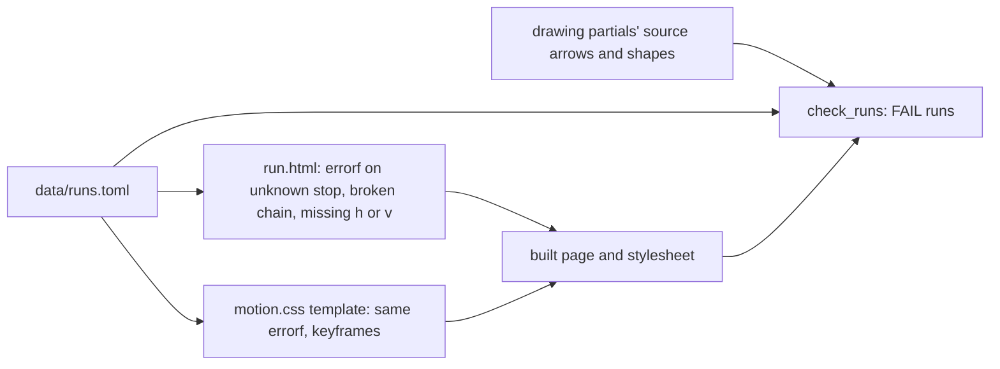
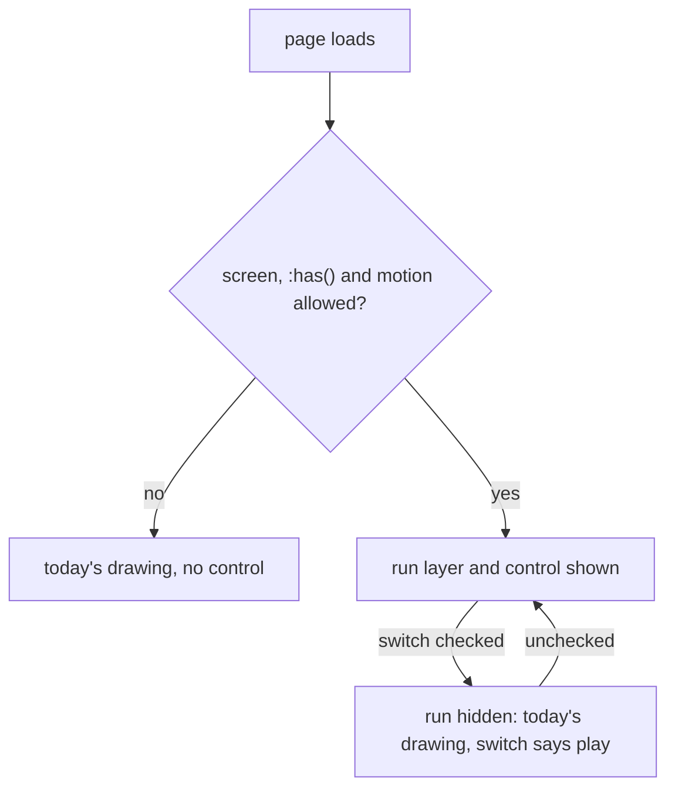

# Diagram animations Implementation Plan

<!-- glance -->
```
Plan: Diagram animations · 5 tasks · ~535 lines · 20 files
 1  [1 fangtype's wide drawing…]
 2  [2 every drawing runs, sev… ←1]
 3  [3 the control at every wi… ←2]  [4 the site check guards t… ←2]
 4  [5 CPU, size, the other dr… ←3,4]

#  does                                                          files  adds                            size
1  Renders fangtype's wide-drawing run layer and its keyframes…  9      `data/runs.toml` (`timing` an…  ~200
2  Adds several runs per cycle and the run layers of fangtype'…  6      `timing.between = 1.5`; `draw…  ~190
3  Places each drawing's control above its top right corner at…  2      nothing new                     ~20
4  Makes `check-site.py` fail when a route leaves its drawing'…  1      `check_runs(out)` in `scripts…  ~90
5  Measures the page's CPU cost and stylesheet size, looks at …  2      nothing new                     ~35
```
<!-- /glance -->

> **For agentic workers:** REQUIRED SUB-SKILL: Use superpowers:subagent-driven-development (recommended) or superpowers:executing-plans to implement this plan task-by-task. Steps use checkbox (`- [ ]`) syntax for tracking.

**Goal:** A pink dot carries a request hop by hop through each of the projects page's six drawings (three systems, wide and upright), looping calmly, with a stop control, and every drawing exactly today's at rest.

**Architecture:** One data file holds every drawing's stops, runs and pauses, written once per drawing, with each shape and hop's points given for both the wide and the upright drawing. A partial renders each drawing's hidden run layer from it, and `motion.css`, run through Hugo as a Go template, computes every keyframe from the same data inside the existing no-preference block. A checkbox above each drawing hides the run layer (stop) and shows it again (play, from the beginning).

**Tech Stack:** Hugo Extended 0.166.0 (Go templates, `hugo.Data`, `resources.ExecuteAsTemplate`, `errorf`), plain CSS keyframes on SVG (`stroke-dashoffset`, `opacity`), Python 3.11+ (`scripts/check-site.py`), Chrome through the T3 preview for frames and pixel diffs, Playwright (WebKit, Firefox, Chromium) from nixpkgs where it runs.

**Spec:** [spec.md](spec.md) (approved at Gate 1, 2026-11-17; one item reopened by plan review round 1). Browser facts: [browser-support.md](browser-support.md).

**Base:** the branch `job-application-portfolio` (the site as it is; `main` is 31 commits behind it). The base commit, before Task 1, is the **baseline** below.

## Global Constraints

- Motion preference: resolved in `assets/css/motion.css` (the no-preference block shows the run layer and the control); never seen by the drawing partials, `layouts/projects.html`, the data file or `content/projects.md`.
- Stop state: resolved in `assets/css/motion.css` (`.fig:has(input:checked) .run{display:none}`); never seen by the drawing partials beyond the checkbox markup, by the data file or by content.
- Routes and timing: resolved in the data file, rendered by one run partial and by the `motion.css` template; never seen by the drawing partials' shapes or by `content/projects.md`.
- Wording (key, stop, play, accessible name): resolved in `content/projects.md`; never seen by CSS, the data file or the drawing partials' shapes.
- One implementation gets no interface; one caller gets no helper; no option nobody sets.
- The owner lifted the projects page's motion freeze for the drawings' run layers only (2026-11-17); everything else on the page stays as approved. Task 1 says so in CLAUDE.md.
- No JavaScript on the site; everything that moves sits in `motion.css`'s one `@media (prefers-reduced-motion: no-preference)` block, which ends the stylesheet.
- Inside a drawing only `opacity` and `stroke-dashoffset` animate (and `animation-timing-function` in keyframes); never `transform`, `translate`, `rotate`, `scale` or `offset-*`. No `vector-effect: non-scaling-stroke` on the dashed dot paths.
- The drawing partials' existing shapes, labels and legends do not change; the only additions are one `run.html` call per SVG and one `runbar.html` call per figure.
- Templates read data with `hugo.Data`, never `site.Data` (deprecated since Hugo 0.156; `check-site.py` builds with `--panicOnWarning`). TOML numbers need a leading digit (`0.6`, not `.6`).
- `scripts/check-site.py` stays runnable on Python 3.11 (CI uses the runner's `python3`).
- Commit messages are one sentence with no co-author lines; stage with `git add -- <paths>`, never `git add -A`.
- Stack pack: none matches (an existing, owner-approved page; hallmark is only for new pages or when the owner names it).

## Review Focus

1. **A browser without `:has()`** (Safari before 15.4, Firefox before 121): the stop control could not hide the run there, so these browsers get no run and no control at all, only today's drawing. Test: Task 1, step 7.
2. **Printing the page:** a printed page shows today's drawings, never a frozen dot or a control. Test: Task 1, step 7.
3. **Resizing across 760 px while a run plays** (where all three drawings switch to upright: every article is `sheet lead`, `layouts/projects.html`, `base.css:156-158`): the drawing that appears starts its own run from the beginning; nothing stays stuck lit. Test: Task 3, step 5.
4. **Keyboard only:** Tab reaches each switch, a focus ring shows, Space stops and plays. Test: Task 1, step 5.
5. **Stopping one drawing:** only that drawing stops; the other two keep running. Test: Task 2, step 5.

## Test seams

- **`python3 scripts/check-site.py`** (the site's own CLI, inside `nix develop`): catches template and build errors (including the templates' `errorf` on bad route data), motion outside the no-preference block, and, after Task 4, a route off its drawing's arrows or components (read from the source files), a run layer without `aria-hidden`, an empty or unwired run layer, and an animation inside a drawing that changes anything but `opacity` and `stroke-dashoffset`. Misses looks, timing and rendering.
- **The built stylesheet** (`nix develop -c hugo --gc --minify --baseURL "https://manuelschuelein.de/" -d <dir>`, then the CSS file under `<dir>/css/`): catches wrong cycle lengths and keyframe offsets, compared as numbers (the minifier writes `15.05s` and `-.996`). Misses rendering.
- **Chrome frames and pixel diffs** (T3 preview, lossless PNG): pause every animation at a cycle time with `document.getAnimations()` (`pause()`, `currentTime = delay + t`), screenshot, and compare crops with Pillow (`ImageChops.difference`, count of differing pixels). Catches at-rest identity, choreography (a contact sheet of 40 frames 0.5 s apart), control placement. Misses Safari, Firefox, real-time smoothness. Traps: read `docs/solutions/checking-motion-in-the-browser-tool.md` first (use `localhost`, fresh tabs, PNG not JPEG; a script `pause()`/`play()` overrides CSS play-state, so control tests need a fresh load). Helpers from the spike, `<scratchpad>` = `/tmp/claude-1000/-home-deadmade-projects-deadmade-github-io/315af9ad-7061-42a5-a117-ad182e551581/scratchpad`: `<scratchpad>/spike-tools/contact.py` (contact sheet page) and `diff.py` (crop diff). Serve a build with `python3 -m http.server <port> --bind 127.0.0.1 -d <dir>` and open it as `http://localhost:<port>/`; the spike v8 is `<scratchpad>/spike/out8` (port 8796), today's site is `<scratchpad>/spike/base` (port 8781).
- **Reduced motion, by query flip:** a fresh copy (`cp -a`, with `.git`) of the tree under test and one of the baseline, each with `motion.css`'s query changed to `(prefers-reduced-motion: reduce)`, built and compared full page. Catches anything the feature changes outside motion. Misses nothing the flip doesn't (both copies lose all motion alike).
- **WebKit and Firefox through Playwright** (`nix shell nixpkgs#python3Packages.playwright nixpkgs#playwright-driver.browsers`): catches an engine that draws no dot. Misses real devices.
- **The owner's eyes** (Chrome, and Safari on an iPhone or Mac before the merge): catches what isn't beautiful or smooth.

Reference timings (the spike's formula, generalised to several runs; `<scratchpad>/spike-tools/ref_timing.py` computes them):

| drawing | cycle | stops | lit spans | hops |
| --- | --- | --- | --- | --- |
| fangtype h | 17.679 s | 8 (+1 span) | 8 | 7 |
| fangtype v | 15.050 s | 8 (+1 span) | 8 | 7 |
| rustlogger h | 20.686 s | 10 | 13 | 11 |
| rustlogger v | 20.829 s | 10 | 13 | 11 |
| isopruefi h | 23.486 s | 9 | 12 | 9 |
| isopruefi v | 23.143 s | 9 | 12 | 9 |

## Pictures

The file map is built from the tasks' **Files** lists. Where a route can go wrong and what stops it (the build, from Task 1; the check, from Task 4):



Which visitors get the run (Task 1, steps 4 and 7):



---

### Task 1: fangtype's wide drawing runs from the data file

**Does:** Renders fangtype's wide-drawing run layer and its keyframes from one data file, with the stop control and its words from content, so the page looks like the approved spike v8.
**Depends on:** none
**Adds:** `data/runs.toml` (`timing` and `drawing.fangtype`); `layouts/_partials/run.html`; `layouts/_partials/runbar.html`; front matter `runbar` (page) and `runkey` (fangtype); `motion.css` becomes a Go template.
**Size:** ~200

**Files:**
- Create: `data/runs.toml`
- Create: `layouts/_partials/run.html`
- Create: `layouts/_partials/runbar.html`
- Modify: `layouts/_partials/drawing-fangtype.html`
- Modify: `layouts/_partials/head.html`
- Modify: `assets/css/motion.css`
- Modify: `assets/css/base.css`
- Modify: `content/projects.md`
- Modify: `CLAUDE.md`

**Interfaces:**
- Produces, the data file:
  - `[timing]`: `speed = 175.0`, `ease = "cubic-bezier(.45,0,.3,1)"`, `fade = 0.2`, `light = 0.25`, `unlight = 0.4`, `start = 1.0`, `rest = 4.5`, `delay = 1.2`, `tip = -0.996`, `leave = 0.15` (an outline starts to fade this long after its dot leaves), `land = 0.08` (an outline starts to light this long before its dot lands).
  - `[[drawing.<name>.stop]]`: `id`, and `h` and `v`, each a shape. A shape is an inline table with one or more of `rect = [x, y, width, height]`, `polygon = "<points>"`, `path = "<d>"`, `text = [x, y, "<label>"]`.
  - `[[drawing.<name>.span]]`: `first`, `last`, `h`, `v` (shapes); lit from the arrival at `first` until the departure from `last`.
  - `[[drawing.<name>.run]]`: `hops = [ { from = "<id>", to = "<id>", wait = <s>, h = [[x, y], …], v = [[x, y], …] }, … ]`, one inline table per line.
  - `<name>` is the project's `drawing` value; `<o>` below is `h` or `v`.
- Produces, markup: `partial "run.html" (dict "name" <name> "o" <o>)` renders `<g class="run run-<name>-<o>" aria-hidden="true">`, then `<g class="hl hl-<id>">` per stop and `<g class="hl hl-span<i>">` per span with the shape's elements (`<rect>`, `<polygon>`, `<path>`, `<text class="c">`) inside, then per hop (numbered `n` from 0 across all runs) `<g class="pu pu-<n>">` holding three paths, classes `h2`, `h1`, `dot`, each with `d="M<x0> <y0>L<x1> <y1>…"` from the hop's `<o>` points and `pathLength="1"`.
- Produces, the templates' guards: `run.html` and the `motion.css` template stop the build with `errorf` when `<name>` has no data, a stop, span or hop lacks the orientation being rendered, a hop's `from` or `to` is not a stop `id`, or a hop's `from` is not the previous hop's `to` within a run.
- Produces, markup: `partial "runbar.html" <project>` renders `<div class="runbar"><span class="lg-run" aria-hidden="true"><svg viewBox="0 0 14 14"><circle class="halo" cx="7" cy="7" r="6"/><circle class="dot" cx="7" cy="7" r="3"/></svg><runkey></span><label class="runctl"><input type="checkbox" aria-label="<runbar.name>"><span class="lbl" aria-hidden="true"><span class="on"><runbar.stop></span><span class="off"><runbar.play></span></span></label></div>`; the page-level words come from `(site.GetPage "/projects").Params.runbar`.
- Produces, CSS: keyframes `run-<name>-<o>-<id>`, `run-<name>-<o>-span<i>`, `run-<name>-<o>-pu<n>` (travel), `run-<name>-<o>-po<n>` (the dot's opacity), for every orientation the data has; every animation runs for that drawing's cycle (printed with 3 decimals; the minifier may trim zeros) with delay `timing.delay`, `infinite`.

- [ ] **Step 1: Write the failing test.** Build into a scratch directory and assert, reading numbers from the built CSS: `@keyframes run-fangtype-h-pu0` exists, and the duration in `.run-fangtype-h .pu-0`'s animation is 17.679 s within 0.0005 s; likewise `run-fangtype-v-pu0` with 15.050 s.

- [ ] **Step 2: Run it.** Expected: FAIL (no such keyframes).

- [ ] **Step 3: Write the data, the partials and the content words.**
  - `data/runs.toml`: the `[timing]` values above and `drawing.fangtype` from **Routes** below, both orientations.
  - `run.html` as in Interfaces; one call in `drawing-fangtype.html` right before the wide SVG's `</svg>`, with `(dict "name" "fangtype" "o" "h")`.
  - `runbar.html` as in Interfaces; one call as the first child of the figure in `drawing-fangtype.html`.
  - `content/projects.md`: page front matter `runbar: {stop: "stop", play: "play", name: "stop or play the animation"}`; fangtype `runkey: "a request"`.

- [ ] **Step 4: Make `motion.css` a template that writes the keyframes.**
  - `head.html:34`: replace `(resources.Get "css/motion.css")` in the Concat slice with `(resources.Get "css/motion.css" | resources.ExecuteAsTemplate "css/motion.css" .)`.
  - Inside the no-preference block, at its end, inside `@media screen{@supports selector(:has(*)){…}}`: `.dwg .run{display:inline}`, `.runbar{display:flex}`, `.fig:has(input:checked) .run{display:none}`, and for each drawing in `hugo.Data.runs.drawing` and each orientation `h`, `v` the rules and keyframes below.
  - Timing, the spike's formula (`<scratchpad>/spike-tools/gen2.py`) for any number of runs. Hop length `L` is the sum of `|dx| + |dy|` over the orientation's points.

    ```
    t = 0
    for each run k:
      lit[first stop of run k] opens a span at t
      t += start
      for each hop (from, to, points, wait):
        dur = max(0.45, 1.25 * L / speed)
        dot n = (t, t + dur)
        close the open span of `from` (and of a span whose `last` is `from`) at t + leave
        t += dur
        open a span of `to` (and of a span whose `first` is `to`) at t - land
        t += wait
      close the open span of run k's last stop at t
      t += unlight (+ between, when another run follows; `between` arrives in Task 2)
    cycle = t + rest
    ```
  - Keyframes, with `pc(x) = 100 * x / cycle` printed with 3 decimals:
    - a stop or span: `0%{opacity:0}`, then per span `[a, b]`: `pc(a){opacity:0}` (left out when `a` is 0), `pc(a + light){opacity:1}`, `pc(b){opacity:1}`, `pc(b + unlight){opacity:0}`; then `100%{opacity:0}`; `linear`.
    - a dot's travel: `0%{stroke-dashoffset:0}`, `pc(a){stroke-dashoffset:0;animation-timing-function:<ease>}`, `pc(b){stroke-dashoffset:<tip>}`, `100%{stroke-dashoffset:<tip>}`.
    - a dot's opacity: `0%{opacity:0}`, `pc(a){opacity:0}`, `pc(a + fade){opacity:1}`, `pc(b - 0.05){opacity:1}`, `pc(b - 0.05 + fade){opacity:0}`, `100%{opacity:0}`; `linear`.
    - `.run-<name>-<o> .pu-<n>{animation:run-…-pu<n> <cycle>s <delay>s infinite,run-…-po<n> <cycle>s linear <delay>s infinite}`.
  - `base.css`, after the drawing rules: the run layer's at-rest styles from spike v8: `.dwg .run,.runbar{display:none}`; `.dwg .hl{opacity:0}`; `.dwg .hl > *{fill:none;stroke:var(--accent);stroke-width:1.5;vector-effect:non-scaling-stroke}`; `.dwg .hl text{stroke:none;fill:var(--accent)}`; `.dwg .pu{opacity:0;stroke-dashoffset:0}`; `.dwg .pu path{fill:none;stroke:var(--accent);stroke-linecap:round;stroke-dasharray:0 2}`; `.dot` 6, `.h1` 12 at stroke-opacity .25, `.h2` 19 at .07; `.fig{position:relative}`; the runbar, key and switch rules of `<scratchpad>/spike-tools/patch2.py` lines 28-42, with the `::after` words replaced by `.runctl .off{display:none}`, `.runctl input:checked + .lbl .on{display:none}`, `.runctl input:checked + .lbl .off{display:inline}`.
  - `motion.css` header comment (lines 1-3): replace "Nothing here touches the projects page's drawings or sheets." with: the file is a Go template reading `hugo.Data.runs`; inside the projects page's drawings only their run layers move, and nothing touches the sheets. (A note for the builder, not comment text: the page's hidden `h1` and its cross-fade still move, `motion.css:12` and `:60` today.)
  - `CLAUDE.md` Gotchas: in the bullet "The projects page's drawings and sheets have no motion (the owner rejected it)…", replace that first sentence with: the projects page's drawings move only through their run layers (owner-approved 2026-11-17) and must look the same at rest, the sheets have no motion, and nothing inside a drawing may animate `transform` (it changed Chrome's rendering of the whole drawing at rest, 12,766 px); keep the rest of the bullet (the page transition, `main:not(:has(.dwg))`, the hidden `h1`, the `both` fill). In the bullet "The projects page's design is owner-approved and must not change…", add that the run layers, `run.html`, `runbar.html` and `data/runs.toml` are the approved exception.

- [ ] **Step 5: Run the tests.**
  - Step 1's test: PASS.
  - The built keyframes against the spike: for n in 0-6, the second and third offsets of `run-fangtype-h-pu<n>` equal those of `fang-pu<n>` in `<scratchpad>/spike/run8.css` within 0.001. Expected: all 7 equal.
  - `nix develop -c python3 scripts/check-site.py`: every line PASS.
  - Chrome at 1400 px wide, fresh load of a local build: pause at the still cycle times 0.5, 6.0, 7.7 and 15.5 s (nothing moving or fading); the fangtype drawing's crop is identical (0 px) to the spike v8's at the same times, and at 15.5 s also to today's page. Moving frames are covered by the keyframe comparison above and judged by eye on a contact sheet (40 frames, 0.5 s apart).
  - Stop and play, fresh load each: before, 23 fangtype animations and `.run` displayed; after a click on the switch, `.run` is `display: none` and the visible word is "play"; after a second click, displayed again. The accessibility tree shows a checkbox named "stop or play the animation". The switch's `label` box is at least 24 px high.
  - Keyboard (Review Focus 4): Tab moves focus to the switch, and the screenshot shows the focus ring; Space toggles it like a click.

- [ ] **Step 6: Try WebKit and Firefox now.** With Playwright from nixpkgs, against the same local build at 1400 px: pause fangtype's wide drawing at 1.4 s (the first dot in flight at full opacity) and at 15.5 s, screenshot in WebKit and Firefox. Expected: a round pink dot with its halo on the Python code → Jedi arrow at 1.4 s; nothing pink but the accept triangle at 15.5 s. If an engine draws no dot: change `stroke-dasharray:0 2` to `stroke-dasharray:0.001 2` in `base.css`, repeat this step and step 5's Chrome comparisons. If Playwright or an engine cannot run here, write that down as not checked; the owner's Safari look then carries it, and say so before Task 2 starts.

- [ ] **Step 7: Check the gates.** In the built CSS, the rules that set `display:inline` on `.run` and `display:flex` on `.runbar` sit inside both `@supports selector(:has(*))` (Review Focus 1) and `@media screen` (Review Focus 2). Under reduced motion (the query flip, both copies fresh), full-page screenshots at 1400 px are identical. Expected: 0 px.

- [ ] **Step 8: Commit.**

```bash
git add -- data/runs.toml layouts/_partials/run.html layouts/_partials/runbar.html layouts/_partials/drawing-fangtype.html layouts/_partials/head.html assets/css/motion.css assets/css/base.css content/projects.md CLAUDE.md
git commit -m "Run fangtype's wide drawing from a data file, with a stop control."
```

### Task 2: every drawing runs, several runs per cycle

**Does:** Adds several runs per cycle and the run layers of fangtype's upright drawing and of both RustLogger and IsoPrüfi drawings, each with its own control and words.
**Depends on:** Task 1
**Adds:** `timing.between = 1.5`; `drawing.rustlogger`, `drawing.isopruefi`; `runkey` for RustLogger and IsoPrüfi.
**Size:** ~190

**Files:**
- Modify: `data/runs.toml`
- Modify: `assets/css/motion.css`
- Modify: `layouts/_partials/drawing-fangtype.html`
- Modify: `layouts/_partials/drawing-rustlogger.html`
- Modify: `layouts/_partials/drawing-isopruefi.html`
- Modify: `content/projects.md`

**Interfaces:**
- Consumes: Task 1's data shape, `run.html`, `runbar.html`, guards and keyframe names, unchanged.

- [ ] **Step 1: Write the failing test.** Build, and assert from the built CSS, as numbers within 0.0005 s, the cycles of all six drawings in the reference table, and that `run-rustlogger-h-pu10` and `run-isopruefi-v-pu8` exist.

- [ ] **Step 2: Run it.** Expected: FAIL.

- [ ] **Step 3: Implement.** Add `between` to `[timing]` and its use to the template's run loop (Task 1, step 4). Add `drawing.rustlogger` and `drawing.isopruefi` from **Routes**. Call `run.html` before every remaining `</svg>` (fangtype's upright; both RustLogger and IsoPrüfi drawings) and `runbar.html` as the first child of the other two figures. Add `runkey: "a log line"` (RustLogger) and `runkey: "a reading or a request"` (IsoPrüfi).

- [ ] **Step 4: Run Step 1's test and the site check.** Expected: PASS, and every `check-site.py` line PASS.

- [ ] **Step 5: Look at all six.**
  - A contact sheet per drawing (40 frames, 0.5 s apart; wide ones at 1400 px, upright ones at 390 px). Expected: one stop lit at a time (fangtype's bracket and label beside review and accept), each dot ends on its arrowhead's tip, a jump inside a lit box is never seen, RustLogger plays the container log then the sensor log, IsoPrüfi plays the indoor reading, the outdoor reading, then the request.
  - At rest (each drawing paused in its rest, the cycle minus 2 s): the wide drawings' crops at 1400 px are identical to the baseline (0 px).
  - Stopping fangtype leaves RustLogger and IsoPrüfi running: after the click, their animations' `playState` is `running` and their `.run` is displayed (Review Focus 5).

- [ ] **Step 6: Commit.**

```bash
git add -- data/runs.toml assets/css/motion.css layouts/_partials/drawing-fangtype.html layouts/_partials/drawing-rustlogger.html layouts/_partials/drawing-isopruefi.html content/projects.md
git commit -m "Run all six drawings, with several runs per cycle for RustLogger and IsoPrüfi."
```

### Task 3: the control at every width

**Does:** Places each drawing's control above its top right corner at every width, adding one line of space above the upright drawing only when motion runs, and proves the drawings, and the whole page under reduced motion, match today's at five widths.
**Depends on:** Task 2
**Adds:** nothing new
**Size:** ~20

**Files:**
- Modify: `assets/css/motion.css`
- Modify: `assets/css/base.css`

**Interfaces:**
- Consumes: `.runbar` and `.fig` from Task 1.

- [ ] **Step 1: Write the failing test.** At 390 px and at 730 px wide (all three upright), for each figure, the control's box overlaps no `text` of the drawing shown. Expected now: FAIL for fangtype at 390 px (the control covers the upright drawing's "language server" label; measured in the spike); the other cases are not yet measured.

- [ ] **Step 2: Implement.** Inside the gated block, add the control's height (its box is at least 24 px, Task 1 step 5) on top of `.fig`'s 22 px top padding above each upright drawing, under the query that shows it: `.lead .fig` below 760 px (`base.css:156-158`; every article is `sheet lead`). Wide drawings get no extra space (spec: upright only); if step 1's test finds an overlap on a wide drawing, stop and take it to the owner. The drawing itself does not change. Keep the spike's inset at 1300 px and up (`right: clamp(16px,2.4vw,34px)`) where the sheet's border needs it.

- [ ] **Step 3: Run Step 1's test.** Expected: PASS for all three figures. Also at 760 px (all three wide): every `.fig`'s computed `padding-top` equals the baseline's (no space added above a wide drawing).

- [ ] **Step 4: Prove at-rest identity at five widths.**
  - For 390, 730, 760, 1000 and 1400 px, and each of the three drawings: the drawing's crop paused in its rest, and the same crop with the switch on stop, are identical to the baseline crop (0 px).
  - Under reduced motion (the query flip, both copies made fresh from the current tree and the baseline): full-page screenshots at the five widths identical (0 px).
  - Screenshots of each sheet at the five widths: the control sits above the drawing's top right corner, clear of every label and inside the sheet. Look at each.

- [ ] **Step 5: Cross 760 px while a run plays** (Review Focus 3). Load at 1400 px, let fangtype run 5 s, resize to 390 px: the upright drawing's animations exist and their `currentTime` is below 2 s after the resize, and no outline of the wide drawing stays visible. Resize back: the wide drawing restarts likewise. Then the same for RustLogger.

- [ ] **Step 6: Commit.**

```bash
git add -- assets/css/motion.css assets/css/base.css
git commit -m "Place the stop control above every drawing at every width."
```

### Task 4: the site check guards the runs

**Does:** Makes `check-site.py` fail when a route leaves its drawing's arrows or components, a run layer shows to screen readers or is empty or unwired, or an animation inside a drawing changes anything but `opacity` and `stroke-dashoffset`.
**Depends on:** Task 2
**Adds:** `check_runs(out)` in `scripts/check-site.py`, reported as the check `runs`; `data` joins the directories `check_seams` scans.
**Size:** ~90

**Files:**
- Modify: `scripts/check-site.py`

**Interfaces:**
- Consumes: Task 1's data shape, markup (`svg.dwg`, `g.run`, `g.hl`, `g.pu`) and keyframe names (`run-…`).

- [ ] **Step 1: Write the failing tests.** In scratch copies of the repository (`cp -a`, with `.git`), break one thing in each and run `nix develop -c python3 scripts/check-site.py`:
  1. unchanged → `PASS runs -`;
  2. `aria-hidden="true"` removed from `run.html` → `FAIL runs -` naming the drawing;
  3. one point of fangtype's jedi→hints hop, upright (the leftward arrow `M200 104H144`), moved off its line by 1 unit (`200,104` to `200,105`; a move along the line is allowed, since a hop may start part-way) → `FAIL runs -` naming the drawing, orientation and hop;
  4. one stop's `rect` 1 unit wider than its component → `FAIL runs -` naming the stop;
  5. the "developer" `text` of fangtype's span moved by 1 unit → `FAIL runs -` naming the span;
  6. `transform:translateX(1px)` added to one `@keyframes run-…` in `motion.css` → `FAIL runs -`;
  7. `.dwg .pu{animation:rise 1s}` added inside the gated block (the home page's `rise` sets `transform`) → `FAIL runs -`;
  8. one hop's `from` misspelled in `data/runs.toml` → `FAIL build -` with the template's `errorf` message;
  9. the whole `{{ range }}…{{ end }}` block that writes the `g.pu` groups removed from `run.html` → `FAIL runs -` naming the empty run layer;
  10. the opacity keyframes renamed in the `motion.css` template (`-po` to `-px`) → `FAIL runs -` naming the unwired hop.

- [ ] **Step 2: Run them.** Expected: no `runs` line in any copy (the check doesn't exist), so copies 1-7, 9 and 10 fail; copy 8 already fails the build through Task 1's guard.

- [ ] **Step 3: Implement `check_runs(out)`**, called from `main()` after `check_seams(out)`.
  - From the source files: read `data/runs.toml` (`tomllib`) and each `layouts/_partials/drawing-<name>.html`, split into its `svg.dwg.h` and `svg.dwg.v`, whose authored `path.ln` use absolute `M`/`H`/`V` (fail on a path it cannot parse; never skip it). For each drawing and orientation: every hop's points lie on one arrow, in its direction (an arrow is a `path.ln` whose next element is a `polygon.ah`, carried on to that arrowhead's second point, its tip; a `path.ln` with no arrowhead after it, fangtype's "developer" bracket, is no arrow, only a span outline; a hop may start or end part-way along it, as in RustLogger's upright split); every stop's and span's shape matches an element of that SVG: `rect` equal to a `rect.bx` (x, y, width, height), `polygon` equal to a `polygon.st` or with the same centroid as a `polygon.acc` within 1 unit (the ring), `path` equal to a `path.ln`'s `d`, `text` equal to a `text` (x, y, content).
  - From the build: in `projects/index.html`, every `svg.dwg` has exactly one `g.run`, with `aria-hidden="true"`, at least one `g.pu` and one `g.hl`; per run layer, its `pu-<n>` and `hl-<id>`/`hl-span<i>` classes equal the `run-<name>-<o>-pu<n>`, `run-<name>-<o>-po<n>` and `run-<name>-<o>-<id>`/`-span<i>` keyframes in the built CSS (each `pu-<n>` has both its travel and its opacity keyframes), and each is named by an animation rule.
  - In the built CSS: every `@keyframes` named by an `animation` in a rule whose selector contains `.dwg` or `.run` sets only `opacity`, `stroke-dashoffset` and `animation-timing-function`; and no such rule sets `transform`, `translate`, `rotate`, `scale` or an `offset-` property.
  - `check_seams` scans `data` with `layouts`, `content` and `static` (`check-site.py:362`).
  - The module docstring's list of where the checks are documented gains `docs/features/diagram-animations/plan.md`.

- [ ] **Step 4: Run Step 1's tests again.** Expected: copy 1 PASS, copies 2-7, 9 and 10 `FAIL runs` with the named reason, copy 8 `FAIL build`; every other check line unchanged. Then run the unchanged copy once under Python 3.11 (`nix develop -c nix shell nixpkgs#python311 -c python3 scripts/check-site.py`, so `hugo` stays on the path). Expected: the same lines.

- [ ] **Step 5: Commit.**

```bash
git add -- scripts/check-site.py
git commit -m "Fail the site check on a route that leaves its drawing, a run layer screen readers see, and any animation inside a drawing beyond opacity and dash offset."
```

### Task 5: CPU, size, the other drawings in other browsers, and the docs

**Does:** Measures the page's CPU cost and stylesheet size, looks at all three drawings in WebKit and Firefox, and makes CLAUDE.md say what is now true.
**Depends on:** Task 3, Task 4
**Adds:** nothing new
**Size:** ~35

**Files:**
- Modify: `CLAUDE.md`
- Modify: `assets/css/base.css` (only if `content-visibility` is kept)

**Interfaces:**
- Consumes: the built site of Tasks 1-4.

- [ ] **Step 1: CPU.** With Playwright's Chromium (CDP `Performance.getMetrics`), the page idle at 1400 px, top of page: `TaskDuration` gained over 20 s, the feature build against the baseline. Noticeable means more than 1 s of extra task time per 20 s (my threshold). If noticeable, try `content-visibility:auto` with a `contain-intrinsic-size` on `.sheet`, measure again, and rerun Task 3, step 4; keep it only if both hold. If Playwright cannot run, write that down as not measured.

- [ ] **Step 2: Size.** Record the built stylesheet's size, raw and gzipped, against the baseline's (accepted: about 37 KB raw, 4.5 KB gzipped more, estimated by plan review). Expected: within 20% of that estimate; a bigger growth goes to the owner.

- [ ] **Step 3: The other drawings in WebKit and Firefox.** As Task 1, step 6, for RustLogger and IsoPrüfi, wide at 1400 px and upright at 390 px, one frame with a dot in flight each. Expected: the dot drawn. If not run, write it down.

- [ ] **Step 4: Update CLAUDE.md.**
  - Project Structure: `data/runs.toml` (every drawing's stops, runs and pauses, once per drawing, and the timing values), `layouts/_partials/run.html` and `runbar.html`, `motion.css` as a Go template reading `hugo.Data`; the `drawing-*.html` line says the partials hold shapes and labels plus the `run.html` and `runbar.html` calls; the `content/projects.md` line lists `runkey` and the page's `runbar` words.
  - Gotchas: the "Projects-page text … the drawing partials hold only shapes and labels" bullet gains the two partial calls; a drawing edit means updating its route in `data/runs.toml`, and check-site's `runs` check fails on a hop off its arrow or an outline off its component; the run words live in `content/projects.md`.
  - Development Commands: `check-site.py` also checks the runs.

- [ ] **Step 5: Run the site check.** Expected: every line PASS.

- [ ] **Step 6: Commit.**

```bash
git add -- CLAUDE.md assets/css/base.css
git commit -m "Say in CLAUDE.md how the drawings' runs are written and what guards them."
```

After the tasks, before the merge (the flow's Finish): the owner watches all three drawings in Chrome and in Safari on an iPhone or Mac; a missing or broken dot there blocks the merge (spec, **Browsers**).

## Routes

Points run from the leaving component's edge to the arrowhead's tip. Waits: `0.6` at a machine step, `0.4` at a load balancer, `1.1` at a run's last stop, review `1.7`, accept `0.7`. Outlines are the component's own shape from the partial (`rect.bx`, or `polygon.st` for review); `rect` is x y width height.

**fangtype**
- Stops (h | v): code `24 82 104 44` | `16 38 120 36`; jedi `24 240 104 44` | `200 40 128 84`; hints `168 82 104 44` | `16 86 120 36`; review polygon `316,86 342,104 316,122` | `26,150 52,168 26,186`; accept ring polygon `400.0,78.4 437.0,104.0 400.0,129.6` | `96.0,142.4 133.0,168.0 96.0,193.6`; libcst `424 240 92 44` | `200 148 128 44`; mypy `574 240 92 44` | `200 250 128 44`; ann `552 82 136 44` | `16 250 120 44`.
- Span review→accept: h path `M316 78V70H430V78` and text `373 62 "developer"`; v path `M26 214V220H126V214` and text `76 236 "developer"`.
- One run (h | v): code→jedi `50,126 50,240` | `136,56 200,56`; jedi→hints `104,240 104,176 220,176 220,126` | `200,104 136,104`; hints→review (1.7) `272,104 316,104` | `26,122 26,150`; review→accept (0.7) `342,104 404,104` | `52,168 100,168`; accept→libcst `430,104 470,104 470,240` | `126,168 200,168`; libcst→mypy `516,262 574,262` | `264,192 264,250`; mypy→ann (1.1) `620,240 620,126` | `200,272 136,272`.

**rustlogger**
- Stops (h | v): containers `8 82 84 40` | `14 34 100 40`; lb1 `142 92 26 20` | `51 94 26 20`; collector `205 80 88 44` | `24 152 80 44`; lb2 `330 82 26 136` | `14 254 220 24`; api `391 80 88 44` | `64 332 120 52`; haproxy `514 82 26 136` | `14 414 220 24`; clogs `579 82 100 40` | `24 482 80 44`; slogs `579 178 100 40` | `144 482 80 44`; loggen `8 178 84 40` | `134 34 100 40`; logsender `124 178 96 40` | `134 92 100 32`.
- Run 1 (h | v): containers→lb1 (0.4) `92,102 142,102` | `64,74 64,94` (the split arrow's first part); lb1→collector `168,102 205,102` | `64,114 64,152`; collector→lb2 (0.4) `293,102 330,102` | `64,196 64,254`; lb2→api `356,102 391,102` | `124,278 124,330`; api→haproxy (0.4) `479,102 514,102` | `124,384 124,414`; haproxy→clogs (1.1) `540,102 579,102` | `64,438 64,480`.
- Run 2 (h | v): loggen→logsender `92,198 124,198` | `184,74 184,90`; logsender→lb2 (0.4) `220,198 330,198` | `184,124 184,254`; lb2→api `356,102 391,102` | `124,278 124,330`; api→haproxy (0.4) `479,102 514,102` | `124,384 124,414`; haproxy→slogs (1.1) `540,198 579,198` | `184,438 184,480`.

**isopruefi**
- Stops (h | v): arduino `6 70 120 48` | `14 24 140 72`; broker `166 70 100 48` | `14 138 140 44`; receiver `306 70 120 48` | `14 228 140 48`; weatherapi `6 190 120 48` | `186 24 140 72`; weatherworker `306 190 120 48` | `186 228 140 48`; influx `460 70 100 168` | `14 304 312 40`; react `606 62 110 44` | `186 388 140 44`; rest `606 132 110 44` | `14 388 140 44`; pg `606 210 110 44` | `14 460 140 40`.
- Run 1 (h | v): arduino→broker `126,94 166,94` | `84,96 84,138`; broker→receiver `266,94 306,94` | `84,182 84,228`; receiver→influx `426,94 460,94` | `84,276 84,304`; influx→rest (1.1) `560,154 606,154` | `84,344 84,388`.
- Run 2 (h | v): weatherapi→weatherworker `126,214 306,214` | `256,96 256,228`; weatherworker→influx `426,214 460,214` | `256,276 256,304`; influx→rest (1.1) `560,154 606,154` | `84,344 84,388`.
- Run 3 (h | v): react→rest `661,106 661,132` | `186,410 154,410`; rest→pg (1.1) `661,176 661,210` | `84,432 84,460`.
