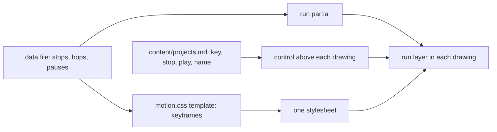
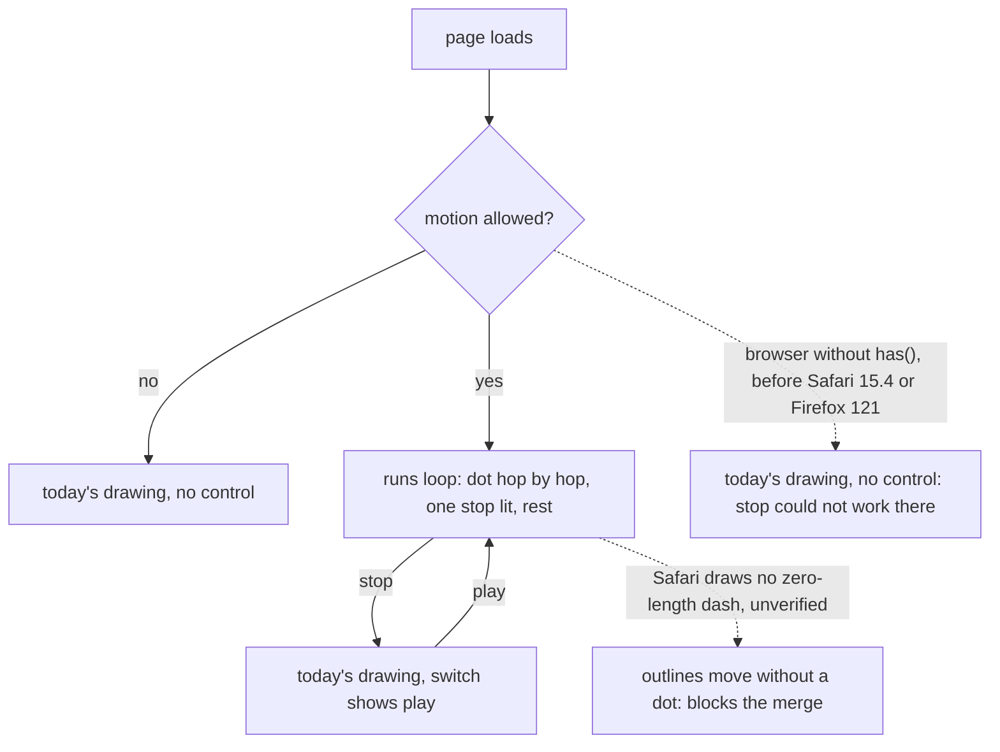

# Diagram animations: spec

Status: approved at Gate 1, 2026-11-17.

## Intent

A visitor to `/projects/` watches a request travel through each of the three systems, from where it starts to where it
ends, one step at a time, beautiful and easy to read. Owner: "they should see how requests travel from the start to the
end in a beautiful and easy to read way!"

The look is the fangtype spike, version 8, which the owner approved on 2026-11-17 ("thats fucking awesome!!"). This spec
carries that look to all three drawings, wide and upright, and makes it part of the site.

## Terms

- **Run:** one request's trip through a drawing, from its first component to its last.
- **Hop:** one step of a run along one existing arrow, from the component it leaves to the one it reaches.
- **Stop:** a component a run reaches; it is outlined while the request is there.
- **Run layer:** the hidden group inside each drawing that holds a run's dots and outlines; the only part that moves.
- **Control:** the key ("● a request") and the stop/play switch above a drawing.

## Goals

- Each drawing shows its runs in order: one pink dot per hop along the drawing's own arrows, and only the component the
  request is in outlined pink.
- It loops calmly: the runs of a drawing, a rest, again.
- Every drawing has a stop control; stop shows the plain drawing, play starts the runs again from the beginning.
- Between runs, and whenever motion is off, the drawing is exactly today's drawing.

## Non-goals

- No motion on the sheets, frames, titles or text of the projects page. Only the run layer moves.
- No hover, tap or scroll triggers; no syncing between the three drawings.
- No pause that keeps the dot frozen in place (stop hides the run instead).
- No change to the drawings themselves: shapes, labels, legend and layout stay as they are.

## Anti-goals

The version the owner rejected on 2026-11-07 (`docs/features/site-animations/flow.md`, Options): lines plotted in,
a pink signal on every arrow at once, hover loops, scroll-linked wipes, plotted sheet frames. Nothing here does any of
that.

## Constraints

- **No JavaScript** (`scripts/check-site.py` fails on any `<script>` but the home page's JSON-LD). The switch is a
  checkbox styled with CSS.
- **All motion in `assets/css/motion.css`**, inside its one `@media (prefers-reduced-motion: no-preference)` block, last
  in the stylesheet (`check_seams` reads the built CSS and enforces it).
- **Identical at rest.** With the run hidden, stopped, between runs or under reduced motion, the drawing's pixels are
  exactly today's (measured in Chrome by lossless screenshot diff, as in the spike).
- **No `transform` animation on anything inside a drawing.** Measured in the spike: one moving `transform` on any SVG
  child changed Chrome's anti-aliasing of the whole drawing at rest (12,766 px, max 50/255). Only `opacity` and
  `stroke-dashoffset` animate.
- **No `vector-effect: non-scaling-stroke` on the dashed dot paths.** A Chromium 151-152 bug broke dashed non-scaling
  strokes at DPR 2 ([browser-support.md](browser-support.md) §2); the spike's dot paths don't use it, the outlines do
  (they have no dashes).
- **Text in content.** Page text lives in `content/projects.md`, not in layouts or CSS (CLAUDE.md). This includes the
  key's words, the switch's visible "stop"/"play" and its accessible name.
- Hugo 0.166, plain CSS, no external requests. Templates read data with `hugo.Data` (`site.Data` is deprecated since
  0.156 and fails the check's build; measured).

## Approaches

Picked by the owner on 2026-11-17 after watching the spike: **A, as built in the spike**.

- **A (picked):** CSS keyframes in `motion.css` time everything. Each drawing carries a run layer: for every hop, a
  copy of the arrow's path (`pathLength="1"`, `stroke-dasharray: 0 2`, round caps) whose zero-length dash is the dot,
  moved by `stroke-dashoffset`; for every stop, an outline of the component. Stop hides the layer.
- **B (rejected):** SVG animation tags (SMIL) in each drawing, chained with `begin`. Looks the same, but moves motion out
  of `motion.css`, needs new check rules, play would likely resume mid-run, and it was not spiked.
- **C (rejected):** CSS `offset-path`. It moves the dot with a transform, which the constraint above rules out; Safari
  support on SVG children unverified.
- **Smallest version (offered, not picked):** a dot without outlines.

How A is written (grill Q1): every drawing's runs live in one data file (`data/`, read with `hugo.Data`), written once
per drawing (changed after plan review round 1, so the wide and upright drawings can't drift apart): its stops (each
with its outline shape, as numbers, in the wide and the upright drawing) and its runs, whose hops each carry the stops
they join, the pause at the stop they reach, and their points in both drawings (from the leaving component's edge to
the arrowhead's tip). Hugo renders the run layer into each drawing from it, and
`motion.css` becomes a Go template (`resources.ExecuteAsTemplate` inside the existing `resources.Concat` in
`layouts/_partials/head.html`) that computes every keyframe from the same data. Measured in a scratch copy: two
fangtype hops computed as 0.814 s and 1.643 s (3.657 s with pauses, the spike's formula), and `check-site.py` passed.
Tuning a pause is one number in the data file, live in `hugo server`.

## Seams

- Motion preference: resolved in `assets/css/motion.css` (the no-preference block shows the run layer and the
  control); never seen by the drawing partials, `layouts/projects.html`, the data file or `content/projects.md`.
- Stop state: resolved in `assets/css/motion.css` (`.fig:has(input:checked) .run{display:none}`); never seen by the
  drawing partials beyond the checkbox markup, by the data file or by content.
- Routes and timing: resolved in the data file, rendered by one run partial and by the `motion.css` template; never
  seen by the drawing partials' shapes or by `content/projects.md`.
- Wording (key, stop, play, accessible name): resolved in `content/projects.md`; never seen by CSS, the data file or
  the drawing partials' shapes.

## The look (from spike v8, approved)

- **The dot:** accent pink, a zero-length round-capped dash 6 units wide on a copy of the arrow, with two faint halos
  (12 at 0.25 opacity, 19 at 0.07). It fades in over 0.2 s as it leaves a component and fades out as it reaches the
  arrowhead tip; it ends at `stroke-dashoffset: -0.996`, since a zero-length dash exactly at the path's end is not drawn.
- **The outline:** the component the request is in gets an accent outline (1.5, non-scaling) over its box. It lights
  in 0.25 s as the dot lands (0.08 s before arrival) and fades over 0.4 s from 0.15 s after the dot leaves. A filled
  shape (fangtype's accept triangle) gets a ring 4 units outside it instead. Nothing stays lit behind the request: no
  trail, no visited marks, no finale. Labels never move, and the only one that lights is "developer", with its bracket
  (as in the approved v8; corrected after Gate 1).
- **Motion:** one easing per hop, `cubic-bezier(.45,0,.3,1)`; travel time `max(0.45 s, 1.25 × length / 175 units/s)`;
  opacity on its own linear animation.
- **Pacing:** 1.2 s delay before the first run on load; the first component alone for 1.0 s before the dot leaves;
  0.6 s at a machine step; the last component held 1.1 s; 4.5 s rest with nothing lit; then again.
- **The control:** above the drawing's top right corner, the key (the dot with its halo and the drawing's words) and
  the switch (a square and "stop"; a pink triangle and "play" when stopped). 12 px, the quiet colour, the pointer's
  colour on hover, a focus ring on keyboard focus, a touch target of at least 24 px high.

## Routes

A route is a list of hops; a hop is one existing arrow, from the edge of the component it leaves to the tip of its
arrowhead, and lights the component it reaches. Each arrow's path ends at the base of its head, 8 units short of the
tip, so the run's copy carries the path on to the tip (my call; the spike did this). Coordinates are the drawing's own
(`layouts/_partials/drawing-*.html`). A drawing with several runs plays them one after another inside one cycle, with a
1.5 s pause between them (my call). A component that is entered and left at different places (a tall or wide box) is
lit while the dot fades out on arrival and in on departure, so the jump is never seen. The wide and upright drawings
play the same runs.

### fangtype: key "a request"

One run, as approved in the spike: Python code → (LSP) Jedi → (LSP) inlay hints → review (held 1.7 s: the developer
decides) → accept (0.7 s) → (LSP) libcst → mypy → (LSP) type annotations. The "developer" bracket lights with review
and accept.

### RustLogger: key "a log line"

- Run 1, a container log: containers → (syslog) nginx lb → collector ×3 → nginx lb → API ×3 → HAProxy → container logs.
- Run 2, a sensor log: log-gen → log-sender → nginx lb → API ×3 → HAProxy → sensor logs.
- The terminal interface stays out of the runs (grill Q3): its only arrow points from nginx to the terminal, while the
  terminal's searches go the other way.
- The load balancers are entered and left at different places: in the wide drawing the sensor log enters nginx at
  y 198 and leaves at y 102, and enters HAProxy at y 102 and leaves at y 198; in the upright drawing the bars are
  entered at x 64 or 184 and left at x 124.
- In the upright drawing one arrow, `M64 74V144`, runs from containers through the small nginx lb box to the collector.
  The run layer splits it at the box's edges (`M64 74V94`, `M64 114V144` plus the head), so the lb is a stop, as in the
  wide drawing (my call; the drawing itself is unchanged).
- Load balancers are passed quickly (0.4 s, my call).

### IsoPrüfi: key "a reading or a request"

Grill Q2: every arrow is used, and no run jumps between two components.

- Run 1, an indoor reading: Arduino devices → (MQTT) MQTT broker → MQTT receiver worker → InfluxDB → (reads) REST API.
- Run 2, an outdoor reading: weather API → (HTTP pull) weather worker → InfluxDB → (reads) REST API.
- Run 3, a request: React → (calls) REST API → PostgreSQL (users and settings).
- InfluxDB is entered at y 94 or y 214 and left at y 154 in the wide drawing, and entered at x 84 or x 256 and left at
  x 84 in the upright one.

## Responsive

The wide drawing (`.dwg.h`) and the upright drawing (`.dwg.v`) each carry their own run layer; only the one shown runs
(the other is `display: none`, so its animations don't exist). The control sits above the drawing's top right corner at
every width (grill Q5). On the lead sheet at 1300 px and up it moves in by the sheet's inner margin, as in the spike.
Where the drawing is upright there is no room for it (22 px above the drawing; measured at 390 px, the control covered
fangtype's "language server" label), so `motion.css` adds one line of space above the upright drawing; the drawing
itself is unchanged, and under reduced motion the page is exactly today's.

## Accessibility

- The run layer is `aria-hidden="true"`; the drawing's `<title>` (the summary) stays its description.
- The switch is a real checkbox, reachable by keyboard, with a focus ring. Its accessible name is "stop or play the
  animation" (grill Q6), so it contains the visible word in both states (WCAG 2.5.3); checked means stopped. Stop
  satisfies WCAG 2.2.2 (a loop over 5 s needs a way to stop it).
- Under reduced motion there is no run and no control.

## Browsers

Grill Q7. During the build, the builder tries Safari's engine (WebKit) and Firefox on this machine. Before the merge,
the owner looks on an iPhone or Mac in Safari. A missing or broken dot blocks the merge; the fallback is a tiny
non-zero dash (for example `0.001 2`) instead of a zero-length one. Facts and sources:
[browser-support.md](browser-support.md).

A browser without `:has()` (Safari before 15.4, Firefox before 121) gets no run and no control, only today's drawing,
because the stop could not work there; a printed page shows today's drawings too (corrected after Gate 1, while
revising the plan: the picture below had the run loop on with a stop that did nothing).

## Checks added to `scripts/check-site.py`

Grill Q8:

- Every run layer is `aria-hidden="true"`.
- Every hop's path lies on an arrow of the same drawing (its line, carried on to the arrowhead's tip), and every outline
  matches a component's shape there (my call, the same guard for outlines), so editing a drawing can't silently break
  its route.
- Nothing inside a drawing animates `transform`.

## Done means

- All six drawings run their routes in Chrome, looked at frame by frame (contact sheets) and by the owner in a browser,
  Safari included.
- Each drawing, at rest, stopped, and under reduced motion, is pixel-identical to today's in Chrome at 390, 760, 1000
  and 1400 px wide (lossless screenshots, cropped to the drawing).
- Stop and play work on a fresh load, by pointer and keyboard; the accessible name is read.
- `scripts/check-site.py` passes, with the three checks above, and fails on a deliberately broken route, a run layer
  without `aria-hidden`, and a `transform` animation inside a drawing.
- An idle page's CPU use is measured in Chrome; if it is noticeable, `content-visibility: auto` on the sheets is tried
  and the at-rest pixels measured again (my call).
- CLAUDE.md and the comment at the top of `motion.css` say what is now true: the drawings move (only the run layer),
  the projects page's look is otherwise still frozen, where routes and timing live, and why `transform` is banned
  inside drawings.

## Pictures

The files the build is expected to touch (a prediction; the data file's and the partial's names are the builder's):

```files
+ data/runs.toml
+ layouts/_partials/run.html
~ layouts/_partials/drawing-fangtype.html
~ layouts/_partials/drawing-rustlogger.html
~ layouts/_partials/drawing-isopruefi.html
~ layouts/_partials/head.html
~ assets/css/motion.css
~ assets/css/base.css
~ content/projects.md
~ scripts/check-site.py
~ CLAUDE.md
```

Where each part comes from at build time: one data file feeds both the markup and the timing, so they can't disagree.



What a visitor gets, and the failure cases:



## Left to the builder

Exact class names, the data file's name and shape, the run partial's shape, where the control's markup is rendered, the
order of rules inside the motion block, the keyframe percentages, and how the spike's tools (contact sheets, pixel
diff) are reused for the checks.
