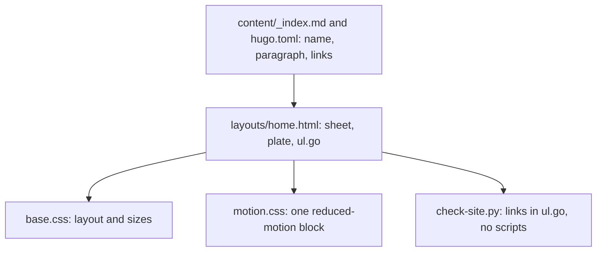

# Home page redesign: spec

## Problem

The home page should be the first thing a recruiter screens in under a minute, and the owner doesn't like today's version. In a blind comparison of 54 generated pages, the owner rated home-18 a 5 and asked to port it, with three changes: no empty space under the picture, a plainer type scale, and new introduction text. The result was settled in a throwaway mockup, [spike/](spike/), which the owner approved ("thats great :D").

## Goal

The live home page (`/`) looks like the spike at every width from 320 to 2560 px, built from the site's own layouts, CSS and content, and passing `scripts/check-site.py`.

Out of scope: the work, path, now and 404 pages; the top bar and the footer (shared by every page, unchanged); any new page or link.

## What the page shows

From top to bottom, as in [spike/shot-desktop.png](spike/shot-desktop.png) and [spike/shot-phone.png](spike/shot-phone.png):

1. **The top bar and the footer**, unchanged from `layouts/baseof.html`.
2. **The sheet**: the site's drawing-sheet frame round the rest of the page, as on the work and path pages: hairlines that overshoot the corners, a centring tick at the top middle and the triangle orientation mark at the bottom middle. The spike's four centring marks give way to these two, so the home page reads as one more sheet of the set.
3. **The plate**, the sheet's upper part, in two cells:
   - Left: the name on two lines, then one paragraph that ends in the pink blinking cursor. There is no separate role line.
   - Right: the profile picture. It fills its cell from the sheet's top edge down to the links, cropped to the cell (a portrait on desktop, 4:3 on phones), with fine static scan lines over it.
4. **The links**: work, path and now in one row of three ruled cells across the sheet's full width (stacked on phones). Each has its triangle, its label and its description from `hugo.toml`. Work's triangle is pink, the others are muted.

## Text

- The paragraph (`content/_index.md`, `lede`): "Backend developer in Bavaria. APIs and ERP integrations in C# by day, Rust and NixOS by night."
- The home page's meta description (`content/_index.md`, `description`) is rewritten to carry the same facts: "Manuel Schülein, backend developer in Bavaria. APIs and ERP integrations in C# and .NET at work, Rust and NixOS at home."
- `params.role` stays "Backend developer". It still feeds the footer and the page metadata; the home page no longer types it out.

Page text: resolved in `content/_index.md` and `hugo.toml`; never written as literals in `layouts/home.html` or the CSS.

## Sizes and layout

Measured in the spike at 1440×900:

- Name: about 180 px, `min(20.5cqi, 19svh, 180px)`, in IBM Plex Mono 700.
- Paragraph: up to 28 px, full ink colour (`--fg`), lines balanced, at most 50ch wide.
- Link labels: up to 39 px; descriptions 16 px.
- On a 1440×900 window the page fits one screen without a scrollbar, as today. Phones scroll.
- The sheet spans the same width as the subpages' content, between the site's `--pad` gutters. The spike's 1440 px cap is dropped: on a 1920 px window it left wide margins and broke the alignment with the bar.

## Motion

All motion stays in `assets/css/motion.css`, inside its one `prefers-reduced-motion: no-preference` block. The page is complete without it.

- Kept from today's home page, on the elements that survive: the name rises and glitches once; the paragraph and the three links rise in turn; the picture fades in; a scanner sweeps down the picture once; the cursor blinks four times and stays.
- Dropped with the elements they animated: the typed role line, and the pink edge drawn along the picture.
- The scan lines are static and need no motion rule.

## Constraints

- The work is cut from the local branch `job-application-portfolio`, where the current site lives; its uncommitted files (`flake.lock`, `.superpowers/`, the two mockups) stay as they are.

- No JavaScript and no external requests (checked by `scripts/check-site.py`).
- The links stay a `<ul class="go">` outside any `<nav>`: the checker reads the home links from `ul.go`, and reads every link inside a `<nav>` as the top bar. The spike's `<nav class="register">` would fail it.
- Hover and focus: the site's current home-link behaviour (the triangle slides 5 px right, the description turns from `--quiet` to `--muted`) and the site's pink focus outline, drawn inside the cell. The spike's hover fill of the whole cell is dropped: it needs a colour the palette lacks.
- Contrast at least 4.5:1 for text; no horizontal overflow from 320 to 2560 px.
- The work page's layout, drawings and CSS don't change.
- `CLAUDE.md` is corrected where it describes the typed role line (`[params]` → `role`).

## Files

```files
~ layouts/home.html
~ assets/css/base.css
~ assets/css/motion.css
~ content/_index.md
~ CLAUDE.md
```

`layouts/baseof.html`, `hugo.toml`, `assets/css/tokens.css` and `scripts/check-site.py` stay as they are.



## Done when

- `python3 scripts/check-site.py` passes.
- Screenshots of the built site at 390, 1440×900 and 1920×1080 match the spike's layout, and nothing overflows at 320 or 2560 px.
- With reduced motion, everything is visible; without it, the motion above plays once.
- The work, path and now pages look the same as before.
