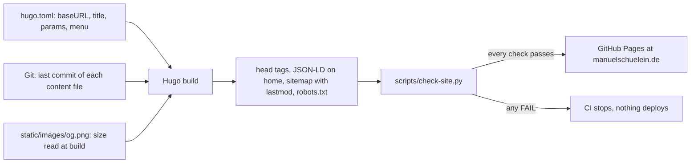
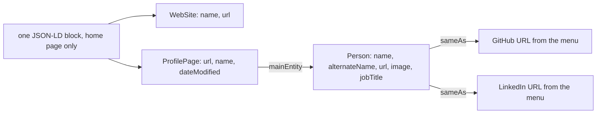

# SEO: design

Status: for Gate 1. Sources: [prior-art.md](prior-art.md) (source-checked), the grounding in [flow.md](flow.md).
Marks: (user) the owner decided it; (my call) I decided it and the owner can reopen it; verified / measured / inferred as in flow.md.

## Intent

The owner wants the site "easily shown when someone searches for my name and also for ai agent that for example look at my application" (user, 2026-11-14). Two readers:

1. **Name searches.** Someone types "Manuel Schülein". The site shows up and looks like him in the result: his name as the site name, his icon, a clean title and description. Search engines learn that the site, his GitHub and his LinkedIn are one person.
2. **AI agents reading an application.** A screening tool, or a recruiter pasting the link into an assistant, follows the link on the application, reads the pages as text and comes away with the right facts.

The site lives at `https://manuelschuelein.de/`, a GitHub Pages custom domain; `deadmade.github.io`, `www.` and `http://` answer 301 to it (measured 2026-11-14). The live build is still `main`'s old site. This work lands on the `job-application-portfolio` branch, on top of the redesign, and goes live with it (inferred: the branch is 23 commits ahead of `main`, 0 behind).

## Pictures

What changes (a prediction from the grounding):

```files
~ hugo.toml
~ layouts/_partials/head.html
+ layouts/robots.txt
- static/robots.txt
~ layouts/now.html
~ content/now.md
~ scripts/check-site.py
~ .github/workflows/hugo.yml
~ CLAUDE.md
```

Where the facts come from, and the gate before the deploy:



What the JSON-LD block on the home page says:



## Goals

- **G1. One host.** Every URL the build writes (canonical, `og:url`, `og:image`, the sitemap, robots.txt's `Sitemap:` line, the structured data) uses `https://manuelschuelein.de`. The host is set once, as `baseURL` in `hugo.toml`; CI keeps passing the Pages address (`.github/workflows/hugo.yml:70`). Hugo renders robots.txt from it (`enableRobotsTXT = true` and `layouts/robots.txt`, verified in the Hugo docs v0.165 robots page), which replaces `static/robots.txt` (my call). `scripts/check-site.py` tests that host (today it tests `deadmade.github.io`, `:18`). The workflow's `--baseURL` stays: the live canonical is `https://manuelschuelein.de/` (measured), so the Pages address CI passes is the custom domain. The domain is held in the repository's Pages settings: an Actions deploy ignores a `CNAME` file (verified, GitHub custom-domain docs), so none is added. The check step also gets that Pages address (`PAGES_BASE_URL`, from `steps.pages.outputs.base_url`), and the check fails when it is set and differs from the check's own host, so a lost or changed custom domain stops the deploy instead of shipping URLs on another host (user, plan review round 1).
- **G2. Site name and profile, as one JSON-LD block on the home page** (user). It holds a `WebSite` node (`name` = the site title, `url` = the home page) and a `ProfilePage` node (`url`, `name`, `dateModified` = the home page's Git date) whose `mainEntity` is a `Person` with `name`, `alternateName`, `url`, `image` (the avatar), `jobTitle` (`params.role`) and `sameAs` (the bar's GitHub and LinkedIn URLs from `[[menu.main]]`). `alternateName` holds "Manuel Schuelein" and the handle "deadmade" (user): the handle is `params.handle`; "Manuel Schuelein" is a new `[params]` value, typed once (my call on where; the key name is the builder's). Every other value is read from `hugo.toml`, the menu or the page; nothing is typed twice. The block carries only facts the home page shows, because Google's quality guidelines forbid marking up content readers can't see (verified, sd-policies); "deadmade" is shown in the bar and the footer, and "Manuel Schuelein" is the visible name spelled without the umlaut (inferred: low risk). It reopens the earlier decision to leave structured data out (`docs/features/job-application-portfolio/spec.md:90`): the owner asks for it now, and Google calls `WebSite` markup "most important" for the site name (verified, site names).
- **G3. Dates from Git.** `enableGitInfo = true`, so each page's `<lastmod>` in the sitemap is the author date of its content file's last commit (verified, Hugo GitInfo; CI already checks out with `fetch-depth: 0`). Google uses `lastmod` only when it is consistently accurate (verified, sitemaps). The now page's visible date ("updated November 2026") comes from the same Git date, printed as month and year, and `updated` leaves `content/now.md` (user). Known limit (my call): a page's date moves only when its content file is committed, so edits to layouts or `hugo.toml` don't move it (inferred from the GitInfo page: the date is the file's last commit); a page whose file has never been committed has no date, and the check requires one on all four pages.
- **G4. Share image details.** `og:image:width` and `og:image:height`, read from the image file at build time with `images.Config` (verified, Hugo docs v0.165), so the numbers never sit in config; `og:image:alt` and `twitter:image:alt`, built from the site title and the role ("Manuel Schülein, backend developer"), which is what the image shows above its tag line (my call). The Open Graph spec says a page with an `og:image` should give its alt (verified, ogp.me).
- **G5. An icon Google can use.** One more `<link rel="icon" type="image/png" sizes="192x192">`, to the existing `static/icons/android-chrome-192x192.png` (my call: no new file). Google takes PNG but not SVG and recommends larger than 48×48 (verified, favicon page); the PNGs linked today are 16 and 32 px (measured).
- **G6. AI agents get the facts as text.** The facts stay in the visible page text (already true: no JavaScript, text in the HTML) and robots.txt keeps allowing every crawler (my calls). The JSON-LD comes on top, not instead: tools that turn a page into text may drop it (a guess, unverified).
- **G7. The check pins it all.** `scripts/check-site.py` fails when any goal above breaks. It allows exactly one `<script type="application/ld+json">`, on the home page only, and still fails on every other `<script`. The block's values must equal what the built site shows (my call): the site's and the person's `name` = the home `<h1>` text; `alternateName` = the new `[params]` value and the bar's mark text, in that order; each `url` = the home canonical; `image` = the avatar's absolute URL; `jobTitle` = the role as the footer shows it, ignoring case; `sameAs` = the bar's `https` links, in order; `dateModified` = the sitemap's `lastmod` for `/`. The now page's visible month and year = those of the sitemap's `lastmod` for `/now/`. No URL in the build may name `deadmade.github.io`. In CI, the Pages address equals the check's host.
- **G8. The docs match.** `CLAUDE.md` names the custom domain, the generated robots.txt, the Git dates (and that `content/now.md` no longer holds a date), the JSON-LD exception to the no-JavaScript rule and where the structured data is built.

## Owner steps (not code)

After the branch is merged and deployed (Search Console and Bing pages verified in prior-art.md):

1. Google Search Console: add a Domain property for `manuelschuelein.de`, verified with a DNS TXT record at the registrar; submit `https://manuelschuelein.de/sitemap.xml`; inspect the home page with URL Inspection (it also shows the structured data) and request indexing.
2. If Search Console shows a setting for generative AI features in Search, keep the site included (Google's two AI pages disagree on whether it is needed).
3. Bing Webmaster Tools: import the site from Search Console.
4. Set `https://manuelschuelein.de` as the website on the GitHub and LinkedIn profiles (inferred: links from those profiles lead search engines and readers to the site).
5. Refresh LinkedIn's cached preview with its Post Inspector (blog source).

## Non-goals

- New pages, longer texts, per-project pages.
- llms.txt (Google Search ignores it; no fetched source says agents read it), IndexNow, a verification meta tag or file (DNS instead), blocking any AI crawler.
- Redirect pages for old URLs: `/categories/` and `/tags/` (in the live sitemap) return 404 after the merge (my call).
- Structured data on the other three pages (employer, studies, projects); the region and the email in the profile (user: the profile stops at the facts in G2).
- Changing `og:type` or Hugo's embedded Open Graph and Twitter templates.
- Any change to the projects page's design.

## Anti-goals

- Markup that says something the page does not show.
- Any script that runs, any request that leaves the site.
- A fact typed twice: host, name, role, handle, profiles, image size, a page's date.
- A check that passes for a host the site no longer uses (the state today).

## Constraints

- `CLAUDE.md`: no JavaScript and no external requests; page text lives in `content/` front matter, not layouts; the projects page's layout, drawing partials and CSS are frozen; plain CSS; motion only in `motion.css`'s last block.
- Hugo: CI pins 0.166.0; local builds use 0.169.0. The embedded `opengraph.html` and `sitemap.xml` are byte-identical in both (verified by the source check).
- `scripts/check-site.py` stays standard-library Python and stays the deploy gate (`hugo.yml:62-63`).
- Google: one `WebSite` node, on the home page; `ProfilePage` needs `mainEntity` with a `name`, on a page whose primary focus is one person (verified). The home page qualifies (inferred: its heading, picture and text are all about the owner).
- Data inside `<script type="application/ld+json">` must stay valid JSON with `<`, `>` and `&` escaped (Hugo's `jsonify` and Go's template escaping both do this; verified, Hugo docs v0.165 `jsonify` and `safe.JS`).

## Approaches

On top of the same groundwork (G1, G3, G4, G5, G6):

- **A. Groundwork only.** The smallest that would work. The site name rests on the title and `og:site_name`, the weaker signals.
- **B. One JSON-LD block on the home page.** Picked (user). Google's recommended format; one node to build and check; the cost is one exception in the check and in `CLAUDE.md`.
- **C. Microdata.** No script element, but `check-site.py` still has to change (its link check fails a `<link itemprop="sameAs">` to GitHub, `:118`), and the markup spreads over `home.html` and `baseof.html`.

## Seams

- Site host: resolved in `hugo.toml` `baseURL` (in CI, the Pages address passed as `--baseURL`); never seen by `layouts/`, `content/` or `static/` (robots.txt is rendered from it).
- Owner facts (name, alternate name, role, handle, profiles, picture): resolved in `hugo.toml` (`title`, `[params]`, `[[menu.main]]`); never seen by `content/`, and read but never restated by the structured-data block.
- Page dates: resolved in Git (`enableGitInfo`); never seen by `content/` front matter.
- Share image size: resolved in the image file (`images.Config` at build time); never seen by `hugo.toml` or the layouts as numbers.
- Structured data: resolved in `layouts/_partials/head.html`, on the home page only; never seen by the page layouts.

## Test seam

`scripts/check-site.py` (the CLI CI runs before deploying): it catches a wrong or old host (in CI also a Pages address other than its own host), a missing or doubled tag, a JSON-LD block that is missing, invalid, on the wrong page or out of step with the page, a sitemap without dates, a now-page date that disagrees with the sitemap, an icon whose file is not the size it claims, and any other script. It misses how Google actually reads the markup; that is owner step 1 (URL Inspection).

## Left to the builder

The template code, the JSON key order, the new `[params]` key's name, how the check parses the block and reads image sizes, and the exact wording of the `CLAUDE.md` lines.
